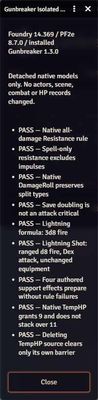

# Live QA evidence — 2026-11-08

Environment observed through the connected Forge browser: Foundry **14.369**, PF2e **8.7.0**, installed Gunbreaker **1.3.0**, 102 active modules and one logged-in GM. The candidate was **not installed**. No campaign actor, HP record, scene or combat document was modified. One new Script Macro, **Gunbreaker — Isolated QA**, was created/saved for the tests.

`node tools/build-live-qa.mjs` generates `tools/live-qa.mjs` from the actual Lightning Shot/support helpers and authored class/weapon data. Executing that script through Foundry's Macro editor constructs detached native actors/effects and rolls without posting damage or changing campaign documents. The temporary-HP checks call native rule methods against local update objects; their chat broadcast is disabled on the detached rule instance.

Observed passes:

1. Native all-damage Resistance rule preparation.
2. Custom spell-only Resistance predicate accepts spell damage and excludes impulses.
3. Native DamageRoll retains split fire/cold instances.
4. Doubling a save-damage roll does not label it an attack critical.
5. Lightning Shot prepares native ranged d8 fire usage with Dexterity and a 30-foot increment, leaving the original weapon unchanged. The environment's displayed formula was `3d8 fire`.
6. All four generated support effect models prepare without ignored rules or missing embedded effects.
7. Native TempHP grants 9 from zero and does not stack over an existing 11.
8. Native effect deletion clears its own temporary HP, while preserving a barrier owned by another source.

The smoke-test harness initially used an invalid short source document ID, so its embedded support effects were rejected by Foundry. Replacing the fixture with a valid generated UUID and asserting that an embedded effect actually exists resolved the harness error; the final support checks passed. An earlier DamageRoll fixture was also corrected to use PF2e's native instance-pool syntax. These were test-fixture corrections, not hidden passing assumptions.

These passes verify **native models and selected rule methods**, not installed executor hooks, live document writes, source-turn expiry, combat geometry, GM/player transport, compatibility with all 102 modules, or migration of an existing campaign character. A second authenticated player session and a disposable test encounter are still required before enabling the experimental settings. Keep the broader checklist in SMOKE-TEST.md.

## Movement and Demoralize follow-up

After PR #11 merged, the same saved QA macro was extended with the actual `suppressingAction` helper. The follow-up observed **13 passing result rows** in Foundry 14.369 / PF2e 8.7.0 (still Gunbreaker 1.3.0), including the earlier model checks and these four additions:

- Native `SingleCheckAction` construction retains `action:demoralize`, adds the module marker and visual trait, removes auditory/language penalty, and leaves the system action unchanged.
- Native fear-effects, mental, emotion and visual immunity all recognize the proposed Suppressing Fire effect source.
- The installation exposes native path planning, movement, stopping and terrain-cost APIs.
- A detached token's native path measurement charges 10 feet for one square of ordinary difficult terrain; the native greater-terrain cost is 15 feet.

The initial immunity fixture incorrectly used `fear` as an Immunity rule type. PF2e's identifier is `fear-effects`. Correcting that fixture and broadening it to mental, emotion and visual immunity produced the final pass; the effect source itself did not require a change.

Public movement methods and the installed cancellation implementation were also inspected through the QA macro: `move()` returns the scene movement result, and `stopMovement()` cancels planned/pending movement initiated by this user. This is compatibility inspection, **not a completed live path-planning/Stride test**. No campaign actor/HP/scene/combat record was changed. The saved macro was restored to the reusable detached checks afterward.

The follow-up screenshot is excluded from the repository because it was captured in a private game.
